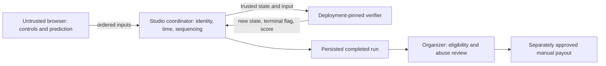

# Server verification: implementation, abuse resistance, and manual prizes

This guide is for developers adapting these games and organizers considering real prizes. Use it alongside the [organizer runbook](organizer-runbook.md), which owns account setup, credit groups, deployment commands, creator authentication, verifier/event publication, and payment recovery.

**Required distinction:** a server-verified result means the pinned game rules calculated the score from server-managed state and accepted inputs. It does **not** mean the player was human, used the official UI, had only one wallet, or is eligible for a prize. Manual prize decisions and payouts remain the organizer's responsibility. These examples are integration references, not independently audited anti-cheat systems.

Platform details below were checked against the Studio implementation on 2026-10-15. Treat numeric execution limits and API behavior as version-specific; repeat the launch checks after platform or game updates. An organizer does not need database, service-role, Cloudflare, or private backend-repository access to follow this guide.

## 1. What must be trusted, and what must not

Assume a player can replace the browser JavaScript, call APIs without your UI, edit local storage, change their clock, automate inputs, disconnect strategically, and create multiple accounts or wallets. Hiding a button, minifying code, checking a React state variable, or keeping an API URL undocumented does not stop them.



The browser may render a predicted score for responsiveness. That display is not an official result. Editing it or a saved recovery record must never create a server result or authorize a prize. The verifier must receive its previous state from the coordinator, **not** from a player-supplied snapshot. A schema can check that a fabricated state is well formed; it cannot establish that the state was earned.

| Boundary | Current responsibility | What it does not establish |
| --- | --- | --- |
| Connect / scoped game authorization | Identify the signed-in wallet/session and scope game/credit access | Human play, one person per wallet, or permission to buy/spend without a separate approval |
| Credit consent and paid `PlaySession` | Bind an explicitly approved credit spend to a paid play; preserve same-operation recovery | That the subsequent game inputs are honest or skillful |
| Run admission | Bind run, player, app, event, deployment, verifier/config and original session; enforce event attempts | A contest-wide one-human cap across wallets, apps or replacement events |
| Coordinator | Own elapsed time, accepted input sequence, state progression and finalization | That a valid input came from a mouse, touchscreen or human |
| Creator-authored verifier | Decide which transitions earn points and when a run is terminal | Fairness of its own rules; a flawed or malicious verifier can award undeserved points |
| Organizer | Publish rules, freeze the build, investigate candidates, record eligibility decisions and pay manually | Automatic fraud detection, automatic disqualification, escrow or automated payouts |

Never use `submitClientAssertedScore`, a community leaderboard, an accepted legacy score, a screenshot, or a browser's `completed` flag as prize authority. Read the creator-only completed server-run feed for the exact contest event.

## 2. Find the score-critical code

| File | Read or change it for |
| --- | --- |
| [`src/target-engine.ts`](../src/target-engine.ts) | Configuration, state/input schemas, deterministic rules, target generation, state transitions, terminal condition and scoring for both variants |
| [`src/server-verifier.ts`](../src/server-verifier.ts) | The isolated Worker request/response adapter; it calls the engine for six supported operations |
| [`src/round.js`](../src/round.js) | Browser prediction, ordered input queue, snapshot checks, same-run recovery and display of the platform's result |
| [`src/config.ts`](../src/config.ts) | Public organizer configuration and the generated scoring configuration |
| [`scripts/package-game.ts`](../scripts/package-game.ts) | Builds the browser and verifier separately and places the verifier/config at the ZIP root |
| [`tests/engine.test.ts`](../tests/engine.test.ts) | Existing wrong-action, replayed-target, timing, score-forgery and protocol checks |
| [`tests/recovery.test.ts`](../tests/recovery.test.ts) | Existing original-key/session recovery, wallet-switch and consent-durability checks |

The browser and verifier share engine code, but execute independently. Sharing a function does not make browser execution trusted. Only the copy invoked by the platform, with platform-owned state and time, determines the official score.

### The actual rules in these two examples

**Target Rush:** `start` begins the timed round. A `hit` scores one point only for the current server-issued target ID after start and before the terminal state. Scoring advances the target ID. A repeated/stale ID cannot score twice. The verifier does **not** receive or validate pointer coordinates, cursor movement, physical clicks, or reaction time.

**Color Match:** a `choose` scores only for the current target ID and the server-selected color. Wrong colors, the other game's `hit` action, stale IDs and input objects with extra fields do not earn points. A wrong answer currently has **no score penalty**; do not advertise a penalty or per-question attempt cap without implementing it server-side.

Both use a strict input-action schema. An input such as `{ action: 'hit', targetId: 1, score: 9999 }` is not a way to set the score: it is ignored by the rules. Invalid game input can still advance time and consume the coordinator's accepted sequence/tick slot; "ignored" does not mean a free retry or a refunded attempt.

### Known automation weaknesses: do not omit these from a prize risk assessment

- `view()` currently returns the entire engine state, including `rngState`, current target/color and rules. The xorshift generator is deterministic and is **not cryptographic**. A random seed at run creation does not keep future targets secret after this state is exposed.
- A script can read the current target ID and send `hit` without clicking the visible target. It can read the requested color and send the correct `choose`. It can also predict subsequent targets from the exposed state.
- A bot can obey sequence numbers and the server's input-rate limit while outperforming a human. Network rate limits and paid entry increase cost; they do not distinguish these inputs from human inputs.
- A wallet proves control of a key, not one unique human. Attempt limits are per event/scoring identity. New wallets or replacement events are not automatically combined into a person-wide limit.
- There is no retained server input replay available to organizers through the completed-results API. A suspicious score may be impossible to adjudicate conclusively after the fact.

**Decision before accepting prize entries:** either explicitly accept a limited, manually adjudicated pilot with appropriate stakes and published automation rules, or improve/review the game-specific controls and evidence first. For a human-skill contest, the unmodified examples are not a sufficient anti-bot assurance. Calling the same exposed answers "server verified" does not resolve that problem.

## 3. Implement the verifier contract correctly

The uploaded root `server-verifier.js` is a bundled ES module exporting a default object with a `fetch(Request)` method. It is invoked privately by the platform, not by the player's browser. Do not add a public endpoint that accepts arbitrary state and writes an official score.

The current adapter accepts **`POST /v1`** with JSON. Its protocol version is the **number** `1`, unlike the string `'1'` used by some public Studio API envelopes. A successful response is exactly `{ "version": 1, "result": ... }`.

| `op` | Trusted fields supplied by the coordinator | `result` and required invariant |
| --- | --- | --- |
| `createRun` | `seed`, published `config` | JSON state object. Validate both inputs; initialize score/time/progress yourself. Same seed/config must have deterministic behavior. |
| `advance` | Previous `state`, `serverTick` | New state object. Advance using that tick; enforce deadlines even if no input arrives. Never move time backwards. |
| `applyInput` | Previous `state`, untrusted `input`, `serverTick` | New state object. Advance time first, parse the action, then validate prerequisites, target, cooldown and bounds before changing score. |
| `view` | Current private `state` | JSON object safe to show the player. For a game with hidden answers or future challenges, return a separate public projection, not the full state. |
| `isFinished` | Current `state` | Boolean. Must agree with terminal rules and remain terminal once finished. |
| `score` | Current `state` | Finite, nonnegative JavaScript safe integer derived from trusted state. Do not read a client score, claimed timestamp or client-provided total. |

See the complete working adapter in [`src/server-verifier.ts`](../src/server-verifier.ts); do not substitute a dummy verifier that always returns a submitted score. Its malformed JSON, unsupported operation/version and invalid state paths return HTTP 400; other methods/paths return 404. A well-formed but illegal **game action** is currently a no-op with a normal state response, not necessarily HTTP 400.

### Time and sequencing belong to the coordinator

The current platform uses **50 ms ticks (20 ticks/second)**, advances from server-observed elapsed time, accepts at most **one input per run per server tick**, and serializes operations. The browser sends this envelope, without state, time or score:

```json
{"type":"input","seq":1,"input":{"action":"start"}}
```

A later Target Rush action could be:

```json
{"type":"input","seq":2,"input":{"action":"hit","targetId":1}}
```

Use consecutive sequence numbers and the target ID from the authoritative state. A replay of the last accepted sequence returns a duplicate acknowledgement without reapplying it; skipped/out-of-order sequences and another input in the same tick are rejected. Do not increment past an unacknowledged operation and assume it scored. The client retains its pending queue and reconciles it against server `inputSeq`/`inputTick`.

The default config is `maxTicks: 240`, `roundTicks: 200`, and the selected `game`. That means up to 10 seconds after the accepted start action, bounded by a 12-second simulation horizon from run creation. Starting late can shorten the playable round; starting twice cannot extend it. Browser animation, `performance.now()` and predicted state are display/input-pacing aids only. Disconnecting does not stop server elapsed time or buy a fresh round.

A run's `expiresAt` is a separate admission/session/event deadline, not a promise of that much active play. Increasing `maxTicks` does not extend the platform's session/event expiry. Keep the deadline checks in `advance` and terminal checks in `applyInput` even when the UI already disables controls.

### Keep the verifier small, deterministic and isolated

Current platform dispatch budgets are **10 ms CPU per invocation**, **zero outbound subrequests**, and a **1-second dispatch timeout**. Config/input objects have 16 KiB adapter bounds, state and response bounds are 64 KiB, and JSON depth/node limits also apply. The browser WebSocket envelope has the tighter **1,024-byte** message limit and a **32-pending-message** per-socket limit. These are availability/safety limits, not promises of anti-bot detection.

This repository's packager rejects a verifier over **256,000 bytes**; the platform source ceiling is 256 KiB. Bundle dependencies into the single root module, avoid growing logs/history inside state, bound every input-driven loop and array, and test the built artifact. The isolated verifier has no organizer database credentials or privileged bindings. Do not rely on network calls, wall-clock reads, `Math.random()`, browser storage, UI dimensions or third-party APIs for a deterministic score.

### Adapting the examples to a third game

1. Write the score rule in plain language first: legal actions, prerequisites, points, penalties, cooldowns, terminal state, time bounds and ties. Decide which mechanics a bot can automate and whether the proposed prize policy can tolerate that.
2. Change the server engine/schema, not just browser scoring. Reject extra action fields and bound IDs, numbers, collections and state size. Validate game-specific movement, inventory, target ownership, cooldowns or resource consumption against previous server state. Browser-only checks are not controls.
3. Separate private state from public view if answers, RNG state or future challenges must stay hidden. This requires updating the client's snapshot schema and prediction/rendering too: the current client deliberately parses a full `TargetState`, so changing only `view()` will break it. Never hardcode a secret in code also bundled into the browser.
4. Derive all score/time changes from trusted state and `serverTick`. Use deterministic, bounded arithmetic; do not accept a claimed "elapsed 10 seconds", collision, success flag or point total as proof. If physical simulation cannot be verified deterministically, move the score-critical simulation to the server or simplify the mechanic.
5. Update `src/config.ts`, variant selection, browser rendering/input handlers, and the rule/config fixtures together. A third game requires code/schema changes; changing a title or JSON `game` string alone is not an integration.
6. Add adversarial behavior tests for the new rule, including legal-looking but impossible transitions and automated optimal inputs. Check multiple seeds, start/deadline boundaries, terminal immutability and deterministic repeatability. Existing example tests are not a complete verifier audit.
7. Build the ZIP and exercise its **bundled** verifier. Freeze/review that artifact and config, deploy it, register the current deployment's verifier version, then create its event. Never silently change the rules of an already announced prize event.

For reaction games, merely adding client coordinates or obfuscating `rngState` does not prove human interaction. Server-side cooldowns, challenge disclosure discipline and bounded resources can limit abuse, but neither they nor a CAPTCHA prove honest play throughout a round. Prefer mechanics whose important transitions the server can meaningfully validate; use independent review and conservative stakes when human-only enforcement remains uncertain.

## 4. Run a complete local verifier exercise without spending credits

From the repository root, run `pnpm install --frozen-lockfile`, `pnpm typecheck`, and `pnpm test`. Then run the following **local-only** protocol exercise. It imports the real Worker adapter, not a mock, uses no network or credentials, and covers both game variants and all six operations.

The harness deliberately supplies its own ticks because there is no coordinator in this local check. It does **not** test production identity checks, WebSocket sequencing/rate limits, payments, or the database's finalization rules.

```sh
node --import tsx --input-type=module <<'NODE'
import assert from 'node:assert/strict';
import verifier from './src/server-verifier.ts';

async function request(payload) {
  return verifier.fetch(new Request('https://verifier.invalid/v1', {
    method: 'POST',
    headers: { 'Content-Type': 'application/json' },
    body: JSON.stringify(payload),
  }));
}

async function invoke(op, fields) {
  const response = await request({ version: 1, op, ...fields });
  assert.equal(response.status, 200, `${op}: expected success`);
  const payload = await response.json();
  assert.deepEqual(Object.keys(payload).sort(), ['result', 'version']);
  assert.equal(payload.version, 1);
  return payload.result;
}

function correctInput(game, state) {
  return game === 'target-rush'
    ? { action: 'hit', targetId: state.target.id }
    : { action: 'choose', targetId: state.target.id, color: state.target.color };
}

for (const game of ['target-rush', 'color-match']) {
  const config = { game, maxTicks: 240, roundTicks: 200 };
  const initial = await invoke('createRun', { seed: 123, config });
  assert.deepEqual(initial, await invoke('createRun', { seed: 123, config }));
  assert.equal(await invoke('score', { state: initial }), 0);
  assert.equal(await invoke('isFinished', { state: initial }), false);
  assert.deepEqual(await invoke('view', { state: initial }), initial);

  const beforeStart = await invoke('applyInput', {
    state: initial, input: correctInput(game, initial), serverTick: 1,
  });
  assert.equal(beforeStart.score, 0);
  const started = await invoke('applyInput', {
    state: initial, input: { action: 'start' }, serverTick: 0,
  });
  const input = correctInput(game, started);
  const invalidInputs = [
    { ...input, score: 999999 },
    { ...input, targetId: started.target.id + 1 },
    { action: 'setScore', score: 999999 },
  ];
  if (game === 'color-match') {
    invalidInputs.push({ ...input, color: started.target.color === 'red' ? 'blue' : 'red' });
    invalidInputs.push({ action: 'hit', targetId: started.target.id });
  } else {
    invalidInputs.push({ action: 'choose', targetId: started.target.id, color: started.target.color });
  }
  for (const invalid of invalidInputs) {
    const unchanged = await invoke('applyInput', { state: started, input: invalid, serverTick: 1 });
    assert.equal(unchanged.score, 0, 'illegal input must not score');
  }
  const scored = await invoke('applyInput', { state: started, input, serverTick: 1 });
  assert.equal(await invoke('score', { state: scored }), 1);
  const duplicate = await invoke('applyInput', { state: scored, input, serverTick: 2 });
  assert.equal(duplicate.score, 1, 'old target must not score twice');
  const restarted = await invoke('applyInput', {
    state: duplicate, input: { action: 'start' }, serverTick: 3,
  });
  assert.equal(restarted.startTick, 0, 'start must not extend the deadline');
  const terminal = await invoke('advance', { state: restarted, serverTick: 200 });
  assert.equal(await invoke('isFinished', { state: terminal }), true);
  const afterEnd = await invoke('applyInput', {
    state: terminal, input: correctInput(game, terminal), serverTick: 201,
  });
  assert.deepEqual(afterEnd, terminal);
  assert.equal(await invoke('score', { state: terminal }), 1);
  const neverStarted = await invoke('advance', { state: initial, serverTick: 240 });
  assert.equal(await invoke('isFinished', { state: neverStarted }), true);
  assert.equal((await request({ version: 1, op: 'advance', state: scored, serverTick: 0 })).status, 400);
  assert.equal((await request({ version: 1, op: 'score', state: { ...initial, startTick: 2 } })).status, 400);

  // This is intentionally allowed: valid automated inputs are not forged scores.
  let automated = started;
  for (let tick = 1; tick <= 20; tick += 1) {
    automated = await invoke('applyInput', {
      state: automated, input: correctInput(game, automated), serverTick: tick,
    });
  }
  assert.equal(await invoke('score', { state: automated }), 20);
  console.log(`${game}: protocol, illegal inputs, replay, deadlines and automation distinction passed`);
}
assert.equal((await request({ version: '1', op: 'createRun', seed: 1, config: {} })).status, 400);
assert.equal((await request({ version: 1, op: 'submitScore', score: 999999 })).status, 400);
console.log('Local verifier exercise passed; no credits, network calls or official runs created.');
NODE
```

A passing result demonstrates the checked transitions, **not** that the games are bot-resistant. The automated-input assertion is intentionally successful: it makes that distinction observable instead of hiding it behind an anti-cheat claim.

### Exercise the built module, not just the TypeScript source

Build each variant using your own approved public configuration as described in the [runbook](organizer-runbook.md#5-build-and-update-the-same-two-apps). For example, if your reviewed Target Rush config is at `./target-rush.config.json`:

```sh
pnpm build -- --config ./target-rush.config.json --output ./dist/target-rush.zip
```

The output must include root `server-verifier.js` and `scoring-config.json`, plus the public client/config assets. Verify this without deploying or using credentials:

```sh
GAME_ZIP=./dist/target-rush.zip node --input-type=module <<'NODE'
import assert from 'node:assert/strict';
import { readFile } from 'node:fs/promises';
import { unzipSync, strFromU8 } from 'fflate';
const files = unzipSync(await readFile(process.env.GAME_ZIP));
assert.ok(files['server-verifier.js'], 'missing root verifier');
assert.ok(files['scoring-config.json'], 'missing matching scoring config');
const config = JSON.parse(strFromU8(files['scoring-config.json']));
const source = strFromU8(files['server-verifier.js']);
const { default: verifier } = await import(`data:text/javascript;base64,${Buffer.from(source).toString('base64')}`);
async function call(op, fields) {
  const response = await verifier.fetch(new Request('https://verifier.invalid/v1', {
    method: 'POST', headers: { 'Content-Type': 'application/json' },
    body: JSON.stringify({ version: 1, op, ...fields }),
  }));
  assert.equal(response.status, 200);
  return (await response.json()).result;
}
let state = await call('createRun', { seed: 123, config });
assert.equal(state.rules.game, config.game);
state = await call('applyInput', { state, input: { action: 'start' }, serverTick: 0 });
const input = config.game === 'color-match'
  ? { action: 'choose', targetId: state.target.id, color: state.target.color }
  : { action: 'hit', targetId: state.target.id };
state = await call('applyInput', { state, input, serverTick: 1 });
state = await call('advance', { state, serverTick: config.maxTicks });
assert.equal(await call('isFinished', { state }), true);
assert.equal(await call('score', { state }), 1);
console.log(`${config.game}: bundled verifier produced the expected terminal score`);
NODE
```

Repeat the archive check with `GAME_ZIP=./dist/color-match.zip` after building that game. These commands import your own built JavaScript and execute it locally: do not run arbitrary third-party verifier archives without reviewing the code or using an appropriate sandbox. They are not substitutes for the platform's isolated-runtime checks or an adversarial review of a new mechanic.

## 5. Deploy and pin the exact rules you reviewed

Use the [runbook's verifier/event publication procedure](organizer-runbook.md#6-publish-a-verifier-version-and-scoring-event). Do not invent a `rare-profile scoring` command or provide player credentials to creator endpoints.

Before admitting entries, record the source commit, ZIP SHA-256, app ID and exact HTTPS origin, deployment UUID, verifier version ID/module digest, config/config digest, event ID, attempt cap and event window. A deployment UUID is not the app ID or an integer build version. The config digest binds the deployment, config and verifier module, not just the game's title. Keep the reviewed artifact and contest rules together.

The upload provisions the private verifier module separately from public game assets. Registration must use the **current published deployment** and its complete matching scoring config. Its current `conformance_status: passed` check invokes **`createRun` with seed `0` and your config** and validates the initial object response. It does not test all six operations, simulate a complete round, audit the score rule, check hidden information, or approve the game for prizes. The local exercises and independent review remain necessary.

Create deliberately bounded events with `authPolicy: 'authenticated'` and a reviewed `maxAttempts`. That policy accepts supported authenticated wallet identities as well as profiles; it is not a unique-person/KYC policy. Avoid the dashboard's unbounded smoke event for a time-limited contest. Active-event discovery selects the newest created currently active event for the current deployment; overlapping/unbounded smoke events can make an unintended event discoverable outside your intended contest window. Use a clean deployment with only the intended bounded event for a real launch.

**No finish-after-close grace is implemented.** The current backend bounds run expiry by session expiry, event end and a 10-minute cap, and rejects new finalization at or after expiry/event end. A round started just before closing may not have time to finish and record a result. Publish an entry/last-start policy with sufficient play and network/recovery margin; do not promise a full round or refund at the deadline. The example does not implement a separate earlier contest last-start cutoff. If that is a requirement, implement and verify the necessary admission control before launch; a browser-only hidden Play button is not enforcement.

Freeze the game and event during the contest. A cosmetic app upload still replaces the current deployment and needs new scoring setup. A replacement event has a new attempt count; it does not preserve a contest-wide cap automatically. Do not resolve a failed verifier, missing event or spent session by switching to a free session, a different ruleset, a fresh paid key, or a client-written score.

### Recovery must preserve the original entry

Keep the paid-start key and the separate server-run key, original event ID, paid session and pinned run/config identity. After a lost start/socket reply, recover the same run with a fresh one-use socket ticket. The current coordinator allows one active socket and consumes its ticket on successful connection; do not log or share the socket URL.

A reload, reconnect or client clock change must not reset server time, restart the attempt or earn another debit. A fresh key on an already-bound paid session is not an extra authorized round. An uncertain payment or reservation needs original-operation recovery/operator reconciliation, not an automatic second charge or refund. Follow the [runbook recovery table](organizer-runbook.md#recovery-rules-uncertainty-is-not-permission-to-charge-again).

## 6. Adversarial acceptance matrix

Run engine checks locally first. Exercise coordinator/API checks only on an authorized test deployment with a reviewed budget and explicit player approval where credits are involved. Do not automate attacks against someone else's contest or spend/grant credits to manufacture a passing result.

| Try this | Required result or decision | Where to check |
| --- | --- | --- |
| Send a huge claimed score, forged state, client timestamp or unknown action | No official score authority; invalid envelope/action rejected or no-op | Local adapter/rules and authorized platform integration |
| Score before start, after terminal, with a stale target, wrong color or the other variant's action | No extra points; deadline never extended | Local rules and bundled verifier |
| Repeat/skip a sequence, race inputs or send two in one tick | No double application; out-of-order/rate-limit handling preserves the pending original operation | Coordinator integration, not just direct `applyInput` calls |
| Oversize/nest inputs or grow state/replay arrays | Bounded rejection/failure; no unbounded CPU, memory or outbound requests | Local rules plus platform-isolated dispatch |
| Replay another player's token, app/event/run ID, or change the verifier/config binding | Admission/snapshot mismatch rejected; no score or entry migration | Authorized platform integration |
| Reload/disconnect around paid start, run start and completion | Same keys/session/event/run; no automatic extra charge, fresh attempt or paused clock | Recovery regressions plus approved integration |
| Reuse a socket ticket or connect two active sockets | Rejected; recover via the original run, not by buying another play | Coordinator integration |
| Run at/near the event deadline or upload a new deployment | No grace/old-event fallback assumed; preserve original evidence and apply published rules | Bounded test event and deployment checks |
| Supply perfect protocol-legal automated inputs | Expect acceptance by these example rules; decide whether human-only prizes can be adjudicated adequately | Local automation demonstration and independent mechanic review |
| Enter through multiple wallets or replacement events | Do not mistake per-identity/per-event limits for a person-wide cap | Organizer eligibility process and contest rules |
| Submit a community/browser score, then inspect the public top score | Never let it become event prize authority; use only the exact event's completed server-run feed | Organizer result-selection procedure |
| Claim that a high score or hash proves cheating or human play | Require evidence and review; neither assertion follows from a score/hash alone | Manual decision record and appeal process |

Existing `pnpm test` coverage checks selected rules and recovery cases; it does not execute every row. Record which checks were local, which reached an approved platform test event, and which remain untested. Do not label a complete paid flow verified merely because a ZIP built or version registration passed.

## 7. Review results before paying prizes

### Publish the decision rules before entries open

Specify included app/event/deployment/rules IDs, window/timezone and deadline behavior, eligibility, allowed inputs/devices/tools, bot/automation and multi-wallet policy, maximum attempts, score aggregation, tie-breaks, review/appeal window, disqualification grounds, outages, refunds and manual payout process. Explain what evidence is available and what a finalist may be asked to provide with consent. Define a conservative response to an inconclusive result instead of promising automatic bot detection.

For these reaction games, low-stakes pilots, delayed payout and an independently observed finalist check can reduce risk. An observed check is corroborating evidence, not a cryptographic proof of every earlier run. Do not invent a new tie-break or mandatory identity requirement after seeing who won. Obtain appropriate legal/payment review for paid entry and prizes; the toolkit is not that review.

### Export the correct feed completely

Use the creator authentication and [completed-results feed procedure](organizer-runbook.md#read-the-creator-only-completed-results-feed):

```http
GET https://studio.superrare.com/api/v1/games/<app-id>/scoring/events/<event-id>/runs?limit=100&offset=0
Authorization: Bearer <creator-session-jwt>
```

Follow `nextOffset` until it is `null`; do not take only the first 100 or truncate at an arbitrary total. This API limits page size to 100 and offset to 1,000,000. If the event exceeds supported pagination bounds, obtain a complete trusted operator export before declaring winners; do not silently drop entries.

The feed includes **completed runs only**, with `id`, `event_id`, `player_id`/`guest_id`, `attempt_number`, `score`, `last_tick`, `started_at`, `ended_at` and `evidence_hash`. Attempts that are active/expired still consume the event attempt cap but are absent from this results feed. It sorts by descending score, then completion time and run ID; that order is not your tie-break policy. Keep score strings precise instead of coercing them through an imprecise spreadsheet number.

Offset pagination is not an immutable snapshot: while new results arrive, pages can shift. Do final exports after closure and settlement of in-flight result recording; retain all pages, deduplicate by run ID, and check a repeat export for consistency. A matching repeat is an operational check, not a server snapshot guarantee. If completeness or finalization remains uncertain, hold payout and ask trusted support; do not claim that the API exposes an all-attempt audit or automatic final standings.

The public top-ten leaderboard and top-score helper span an app's completed events/deployments. They are useful player UI, **not** the complete eligible entrant list or a weekly/event-specific prize ledger. For a two-game contest, collect each event separately and apply a published identity/normalization/aggregation rule. Raw scores and game-scoped identity IDs are not automatically comparable across games.

### Keep an explicit manual review record

For each candidate, record at least:

- Contest rule version; app, event, deployment, verifier and config identifiers; source/artifact hashes.
- Run ID, scoring identity reference, attempt number, exact score, timestamps and evidence hash from the trusted export.
- Checks performed, anomalies, supporting evidence, reviewer/date, decision (`eligible`, `held for review`, or `disqualified`) and reason under a prepublished rule.
- Tie resolution, appeal decision and resulting eligible ranking; the original exported row must remain intact.
- Separately verified recipient identity/address, approved prize asset/network/amount, payment approval and eventual transaction receipt. Never infer a payout address from a game-scoped identity ID.

A high score, repeated perfect play, implausible timing across many completed runs or related-account patterns can justify investigation. They are not individually conclusive proof of cheating; the current feed does not expose per-input reaction times. Do not retrospectively claim to have analyzed input timing that you did not retain.

**Evidence-hash limitation:** the coordinator hashes run/config identity, final verifier state and last accepted sequence before recording the result. That hash is a commitment to a particular final state, not an input replay, public proof of human skill, or a way to reconstruct missing actions. Client screenshots, local storage and client-supplied logs can be edited. If reliable review needs server-retained input traces, timestamps or other telemetry, implement and review that capability before collecting entries; it is not supplied by this repository's completed-results API.

Disqualification is an organizer decision in this workflow. There is no documented server-run disqualification/deletion endpoint or automatic recalculation of the public board here. Preserve the raw results and a separate decision log, then recompute eligible winners under the published policy. Do not delete evidence, rewrite scores in the database, or pretend the public UI has been moderated automatically.

Keep tokens, session credentials and one-use socket URLs out of review records, screenshots, public issues and exports. Retain only necessary personal information with consent, access controls and a stated retention policy. Escalate unverifiable payment/credit history through trusted support; do not manufacture eligibility by editing balances.

Pay only after the review/appeal period, recipient verification and organizer approval. Credit-sale funds in the configured treasury are not escrow or an automatically calculated prize pool. No example command identifies winners, transfers prize money, guarantees refunds or resolves tax/legal obligations.

## 8. Minimum go/no-go checklist

- [ ] A reviewer other than the rule author understands and has checked every score-changing server transition.
- [ ] Source, built verifier, complete scoring config, deployment and event are pinned to the reviewed versions; both local exercises pass.
- [ ] Hidden information is truly absent from public views where the mechanic needs secrecy; remaining automation weaknesses are documented and acceptable for the announced stakes/policy.
- [ ] Invalid actions, replay, time boundaries and resource bounds were checked; authorized coordinator tests and any untested cases are recorded separately.
- [ ] Paid-entry recovery, wallet scope and original-run behavior are understood; no new charge, free-session fallback or automatic refund is used to mask a failure.
- [ ] Event bounds, attempt identity limits, deadline/last-start behavior and deployment freeze are explained to entrants; no unbounded smoke event can accidentally become the prize event.
- [ ] The organizer can obtain complete event-specific results and has enough trustworthy evidence to apply the announced rules; insufficient evidence means hold/stop, not invent proof.
- [ ] Eligibility, automation, multi-wallet, tie, disqualification, appeal and manual payout rules are published; prize funds, recipient verification and legal/payment review are arranged.

If a required check fails, stop admitting new prize entries and preserve existing payment/run evidence while resolving the issue. Do not change an ongoing contest's scoring rules or destroy recovery records to make the problem disappear.
